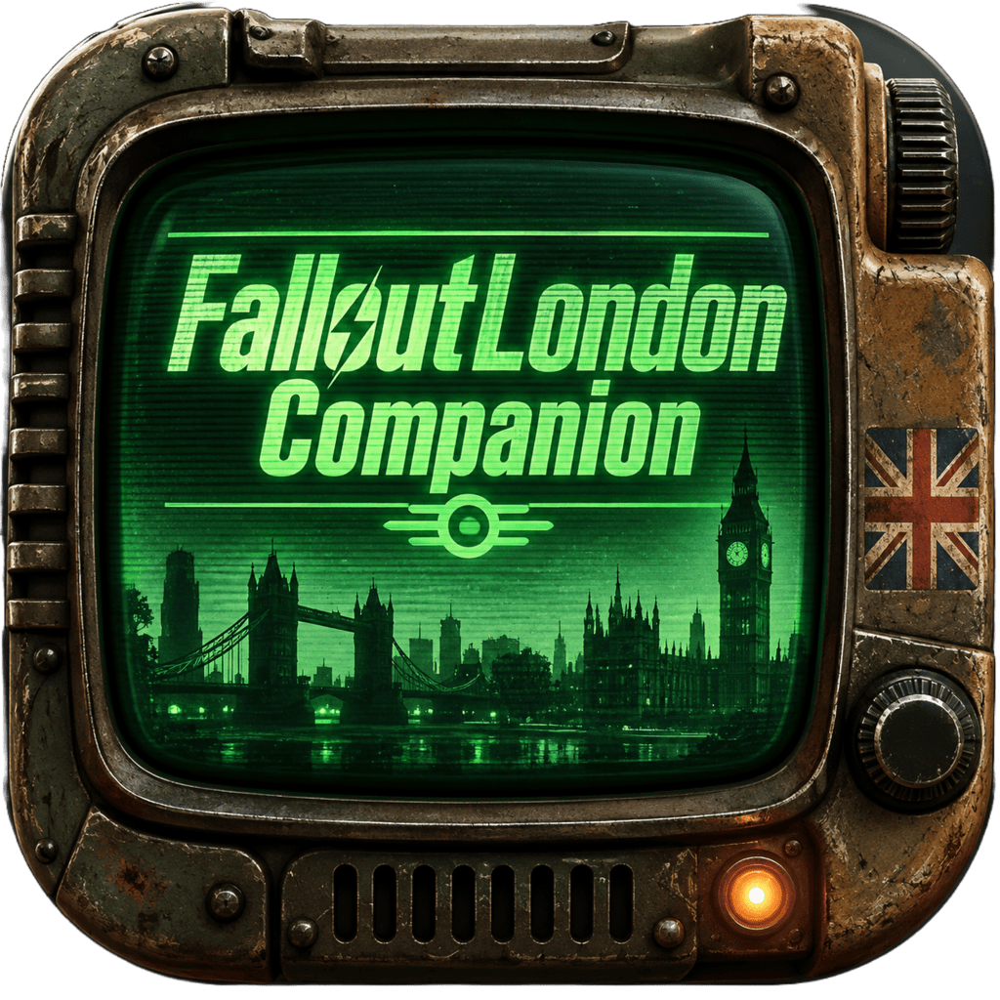

# Fallout London Companion

  

An independent, multi-platform **ATTA-Boy-style companion app** for **Fallout: London** and **Fallout 4**. Select London or the Commonwealth in Settings; the ATTA-Boy branding and interface remain the same. It connects to your game over your home network and shows your Pip-Boy data on a second screen: status, inventory, quests and data, map, and radio.

> **Not affiliated with, endorsed by, or sponsored by Bethesda or Team FOLON.** See [Legal](#legal-and-attribution).

| | |
|---|---|
| **Platforms** | iPhone / iPad, Android, Windows, Linux |
| **Game** | Fallout: London or Fallout 4 (Commonwealth), running on **PC** on the same private network as your device |
| **Status** | Early release (`1.00`). Builds on all four platforms; **not yet verified against a live Fallout: London session**. See [Status](#status-what-works-and-what-is-unverified). |

## Features

- **STAT** – HP and AP, radiation, carry weight, level and XP, SPECIAL, limb condition, active effects.
- **INV** – inventory by category, search, item details.
- **DATA** – quests and objectives, plus a searchable browser over the raw live database (copy or save as text on iOS).
- **MAP** – selectable London / Commonwealth world profile, live game-provided coordinates and discovered locations. All four platforms render the same coordinate-plot experience; an offline Commonwealth basemap is not bundled.
- **RADIO** – station list and state.
- **Medical** – manual Stimpak / RadAway buttons and an opt-in **Auto-Stimpak** (see [Safety notes](#safety-notes)).

The game is always the authority. The app only reports an action as done when the game confirms it or the next game update shows it.

## Install

Download the latest package from the [Releases](../../releases) page and check it against `SHA256SUMS-X.YY.txt`.

| Platform | File | How |
|---|---|---|
| **iPhone / iPad** | `…-iOS-unsigned.ipa` | The IPA is **unsigned**. Open it in a compatible sideloading tool and sign it with your Apple ID. Free-account installs may expire and require refreshing; check your signing tool's current limits. Requires a compatible iOS version. |
| **Android** | `…-Android.apk` | Allow installing from your browser/file manager, then open the APK. This is a **debug build**, not a Play Store release. |
| **Windows** | `…-Windows-Installer.msi` or `…-Windows-Portable.exe` | Run the installer, or run the portable EXE directly. |
| **Linux** | `.AppImage`, `.deb`, `.rpm`, `.flatpak` | Make the AppImage executable and run it, or install the package for your distro. |

## Connect to your game

1. Start Fallout 4 / Fallout: London on your PC and load into the game.
2. Put your phone/PC on the **same private network** as the gaming PC (home Wi-Fi, not a guest network).
3. Open the app and tap **Auto Discover**. If nothing is found, type the gaming PC's local IP address (for example `192.168.1.40`) and tap **Connect**. The last IP you used is remembered on iOS.

Find the PC's IP on Windows with `ipconfig` in a terminal and look for the IPv4 address of your active adapter.

**How discovery works:** the app sends a small UDP request to port **28000**, and the game answers from its own address. On iOS the app also probes addresses on its local /24 subnet because plain network broadcast can be restricted by the platform.

### Troubleshooting

- **Nothing found / cannot connect.** Check that the game is running and loaded, that both devices are on the same subnet, and that your router isn't isolating Wi-Fi clients ("AP isolation" / "guest network").
- **Windows Firewall.** Allow the game through on **private** networks. The companion service uses **UDP 28000** and **TCP 27000**.
- **iPhone: "Local Network" prompt.** If you tapped *Don't Allow*, enable Local Network access for this app in iOS Settings.
- **Game says it's busy / connection refused.** The Pip-Boy service may accept one companion at a time. Close the official app or other companions and retry.
- **The companion service doesn't start at all.** Some Fallout 4 runtimes may need a compatible companion-service enabler; see reference 8 below.
- **A different subnet** (for example PC on Ethernet, phone on Wi-Fi in another range) may prevent auto-discovery. Enter the PC's IP manually.

## Safety notes

- **Use only on a trusted private network.** The Pip-Boy protocol has **no authentication and no encryption**; anyone on the network who can reach the game can read its data and send commands. Never expose TCP 27000 or UDP 28000 to the internet (no port-forwarding).
- **Auto-Stimpak** is off by default. When enabled it is rate-limited (max 3 per minute, spaced at least 4 seconds apart), waits for the previous use to actually raise HP before firing again, and turns itself off if the game reports an error.
- **Fast Travel and Radio control are disabled by default** behind an *Experimental commands* switch, because their command arguments have not been verified against a real game. Turn them on only if you're happy to test them.

## Status: what works and what is unverified

Automated tests and CI cover the protocol decoder, the object graph, and packaging on all four platforms. They **do not replace testing against a real Fallout: London session**.

| Area | State |
|---|---|
| Packet framing, handshake, heartbeat, binary database updates | Implemented and unit-tested on all platforms (synthetic fixtures) |
| UDP discovery and TCP connect | Implemented; needs on-device validation |
| STAT / INV / DATA / MAP / RADIO screens | Implemented; London-specific paths and IDs unverified |
| Stimpak / RadAway actions | Implemented; RPC arguments unverified against London |
| Fast travel, radio toggle, quest and map-marker commands | **Experimental / unverified** |
| Local-map pixel rendering | Implemented per spec; unverified against a real packet |
| London world-map basemap | **Not bundled yet** |
| Xbox | **Not supported** |
| Feature parity across platforms | iOS is the reference; others lag |

The app does not invent world geography or treat a command as supported just because the same numeric ID exists in a Fallout 4 reference.

**Want to help verify?** A capture of a real Fallout: London session (handshake, a few minutes of updates, and a local-map packet) is the single most valuable contribution. See [Contributing](#contributing).

## Platform technology

| Platform | UI / language | Package |
|---|---|---|
| iPhone / iPad | SwiftUI | Unsigned IPA |
| Android | Kotlin + Jetpack Compose | APK (debug) |
| Windows | Kotlin/JVM + Compose Multiplatform (Desktop) | MSI and portable EXE |
| Linux | Kotlin/JVM + Compose Multiplatform (Desktop) | AppImage, DEB, RPM, Flatpak |

The iOS app is the protocol reference implementation. Android and desktop share a common design but currently carry **separate copies** of the protocol code; keep them in sync until they are merged into a shared module.

## Protocol

| Service | Port | Purpose |
|---|---:|---|
| UDP | 28000 | PC companion auto-discovery |
| TCP | 27000 | Data and command stream |

Frames are a 5-byte header (little-endian `UInt32` length + `UInt8` type) followed by the payload. See the documents below for details.

- [Protocol contract and verification limits](Documentation/PROTOCOL.md)
- [Reference-source register](Documentation/REFERENCE_SOURCES.md)
- [Multi-game support and Commonwealth map provenance](Documentation/MULTI_GAME_SUPPORT.md)
- [Shared cross-platform contract](Shared/README.md)
- [UI scaffolding checklist](Documentation/SCAFFOLDING_CHECKLIST.md)
- [Asset provenance](Documentation/ASSETS.md)
- [Release process](Documentation/RELEASING.md)

### Reference sources

Community reverse-engineering references used for research and cross-checking (not copied wholesale):

1. [PyPipboy](https://github.com/matzman666/PyPipboy)
2. [Pipboy specification](https://github.com/mattbaker/pipboyspec)
3. [pipboylib](https://github.com/RobCoIndustries/pipboylib)
4. [NimVek/pipboy](https://github.com/NimVek/pipboy)
5. [MrPippy](https://github.com/ekimekim/mrpippy)
6. [PipBoyClient](https://github.com/cpopp/PipBoyClient)
7. [Pipboy Explorations](https://github.com/mattbaker/pipboy-explorations)
8. [Pip-Boy Companion App Enabler (AE)](https://www.nexusmods.com/fallout4/mods/108133) – context on companion-service availability in modern Fallout 4 runtimes; not a protocol specification.

These describe the Fallout 4 protocol. Upstream projects keep their own licenses; GPL-licensed code must not be copied here without a deliberate license-compatibility review.

## Building from source

CI builds every platform on each push to `main` (see [`.github/workflows`](.github/workflows)). To build locally:

- **iOS:** macOS with Xcode and [XcodeGen](https://github.com/yonaskolb/XcodeGen). Run `xcodegen generate`, open `AttaBoy.xcodeproj`, and run the `AttaBoy` scheme. Unit tests: `AttaBoyTests`.
- **Android:** open `Android/` in Android Studio, or run `./gradlew testDebugUnitTest assembleDebug` inside it. The build expects the pinned icon described in [ASSETS.md](Documentation/ASSETS.md).
- **Desktop (Windows/Linux):** open `Desktop/` in IntelliJ IDEA, or run `gradle test` inside it.
- **Protocol fixtures:** `python3 Shared/tools/generate_and_verify_fixtures.py` checks the shared test packets against an independent reference decoder.

## Contributing

Bug reports are welcome; please use the issue template and include your platform, app version, and Fallout version/mods. Do **not** post private Team FOLON material, Bethesda assets, or anything covered by a private permission. Changes go through pull requests to `main`; CI must pass on all four platforms.

## Legal and attribution

The approved project icon is locked artwork. Android and desktop CI retrieve the exact PNG from the original companion repository at pinned commit `b2e544f4279ddfbe3184b573de04b4104906f7f3`; see [ASSETS.md](Documentation/ASSETS.md).

Do not commit Bethesda game assets, decompiled proprietary code, private Team FOLON material, private Discord conversations, or permission correspondence. Confirm redistribution rights for each third-party asset before including it.

**WITH THANKS TO TEAM FOLON**

Fallout: London is a Team FOLON project. Fallout, Pip-Boy and related marks and assets belong to their respective owners. This independent companion does not imply endorsement or affiliation.
